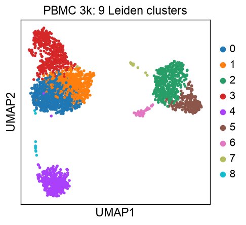
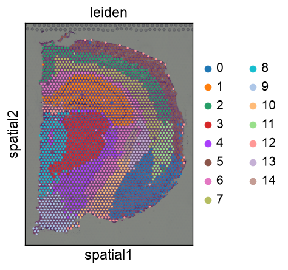
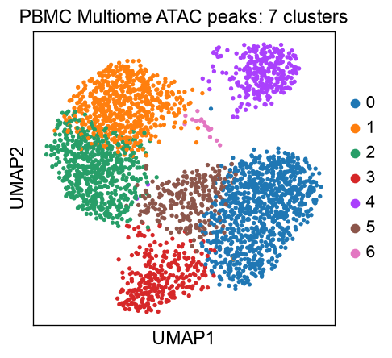
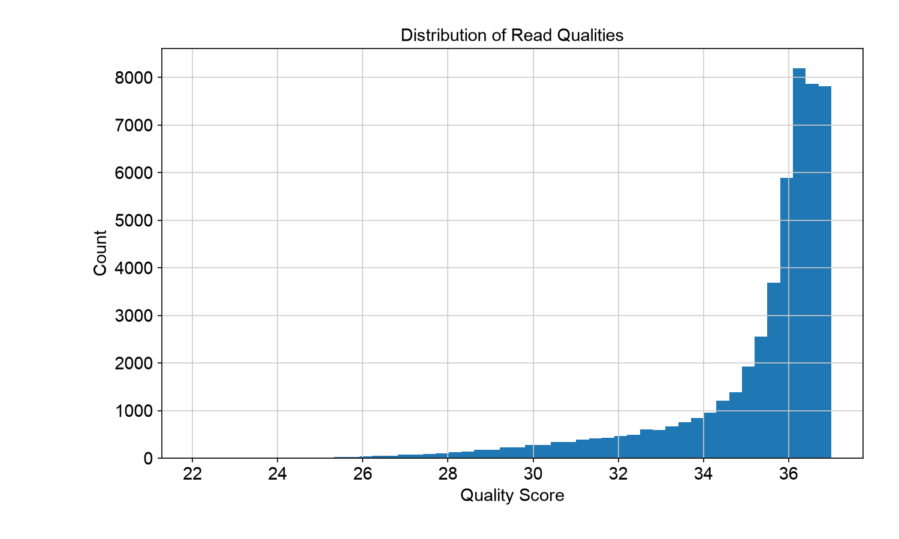
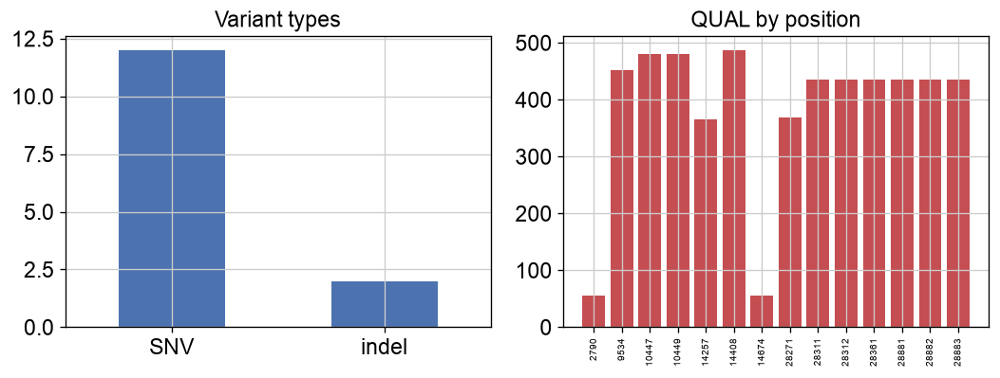

# Bioinformatics Portfolio

This repository showcases a comprehensive set of bioinformatics analyses and skills.

**Featured:** [Baseline CD8 exhaustion burden predicts checkpoint-blockade response](docs/scrna_icb_response.md) — end-to-end reanalysis of GSE120575 from raw GEO files. AUROC 0.86 (n=19), replicated across three independent parameterizations.

## Projects

1. Variant Analysis Pipeline
2. Sequencing Quality Control
3. Genomic Data Preparation
4. Single-cell RNA-seq Analysis (Seurat)
5. Single-cell RNA Sequencing Analysis (Scanpy)
6. Spatial Transcriptomics Analysis
7. Single-cell ATAC-seq Analysis (Signac/Seurat)
8. Single-cell ATAC-seq Analysis (Scanpy/Episcanpy)
9. ICB Response Biomarker: CD8 Exhaustion Predicts Checkpoint Blockade Response (GSE120575)

## Example runs on real public data

`python examples/run_examples.py` runs the `src/` modules on public data and writes figures to `docs/figures/`
(scRNA: 10x PBMC 3k; spatial: 10x Visium mouse brain; scATAC: 10x PBMC 3k Multiome peaks; QC and variants: a public
SARS-CoV-2 Illumina run and the VCF from [nf-variant-pipeline](https://github.com/syed1789/nf-variant-pipeline)).

| Module | Data | Result |
|---|---|---|
| `scrna_scanpy` | PBMC 3k, 2,700 cells |  |
| `spatial_transcriptomics` | Visium mouse brain |  |
| `scatac_scanpy` | PBMC Multiome peaks, 2,962 cells |  |
| `quality_control` | 50,000 SARS-CoV-2 reads |  |
| `variant_analysis` | 14 SARS-CoV-2 calls |  |

Also see `docs/figures/spatial_moran_top.png`, `scrna_qc.png`, `qc_gc_content.png`.
Not run here: `scrna_seurat` and `scatac_signac` (rpy2 wrappers; the same analyses run natively in R in
[scATAC-WNN-multimodal](https://github.com/syed1789/scATAC-WNN-multimodal) and the checkpoint-blockade analysis above) and
`data_preparation` (needs a paired genotype/phenotype table).
`variant_analysis.load_vcf` now reads the `#CHROM` header and gzipped VCFs; `filter_variants` needs a `MAF` column that these calls do not have, so the example does not use it.

## Setup

1. Clone this repository
2. Install required Python packages: `pip install -r requirements.txt`
3. Install required R packages: `R -e "install.packages(readLines('r_requirements.txt'), repos='http://cran.rstudio.com/')"`
4. Run tests: `pytest tests/`

## Usage

Each analysis can be run independently. See individual documentation in the `docs/` directory for details.

## Documentation

Detailed documentation for each analysis can be found in the `docs` directory:

- [Variant Analysis](docs/variant_analysis.md)
- [Sequencing Quality Control](docs/quality_control.md)
- [Genomic Data Preparation](docs/data_preparation.md)
- [Single-cell RNA-seq Analysis (Seurat)](docs/scrna_seurat.md)
- [Single-cell RNA-seq Analysis (Scanpy)](docs/scrna_scanpy.md)
- [Spatial Transcriptomics Analysis](docs/spatial_transcriptomics.md)
- [Single-cell ATAC-seq Analysis (Signac)](docs/scatac_signac.md)
- [Single-cell ATAC-seq Analysis (Scanpy)](docs/scatac_scanpy.md)
- [ICB Response Biomarker — CD8 Exhaustion](docs/scrna_icb_response.md)

## Contact

Syed Nurul Hasan - [nayanchoto1789@gmail.com]

