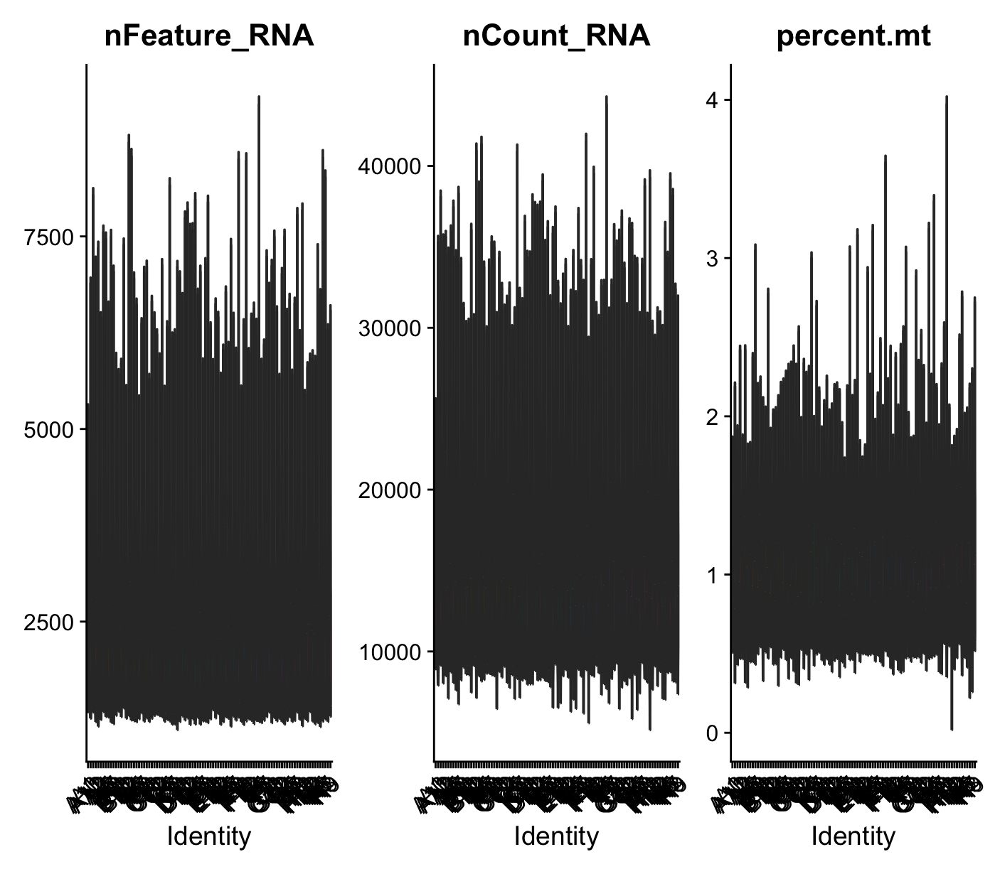
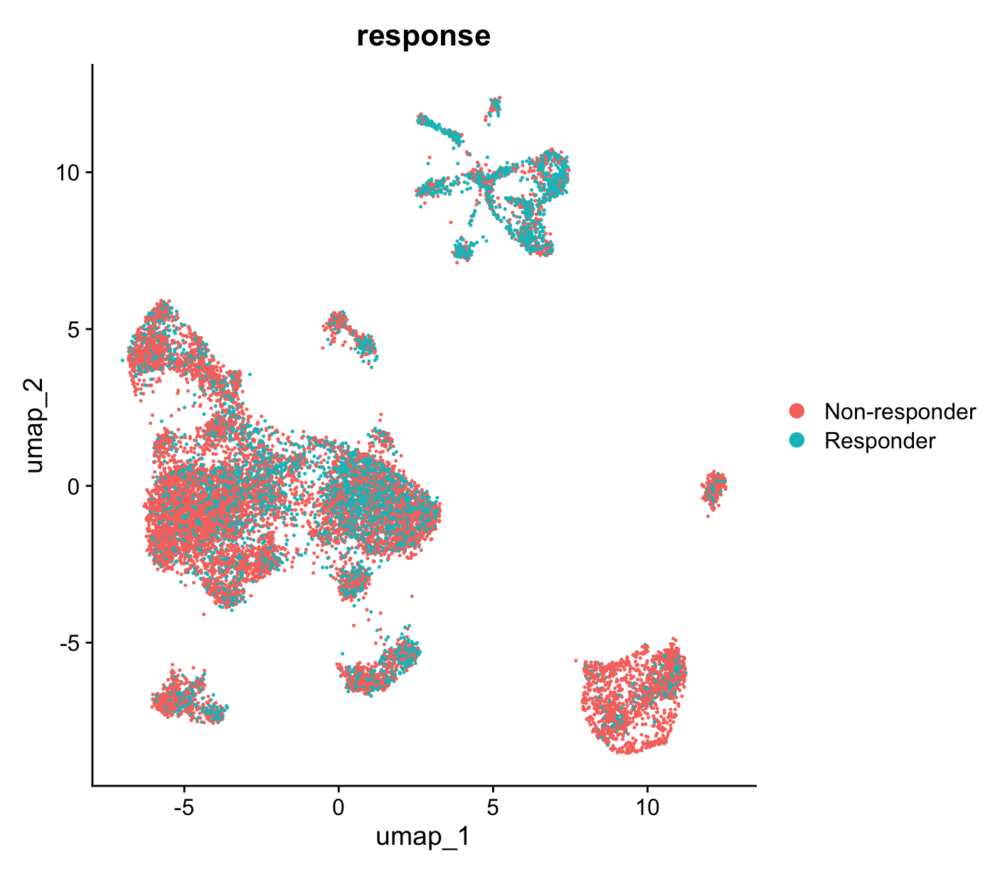

# ICB Response Biomarker: Baseline CD8 Exhaustion

An end-to-end single-cell reanalysis of **GSE120575** (Sade-Feldman et al., *Cell* 2018), rebuilt from raw GEO files: loading → QC → integration → marker-validated annotation → patient-level differential abundance → biomarker evaluation.

**Stack:** R · Seurat v5 · Harmony · SingleR · compositional analysis (CLR) · pROC

## Result

Non-responders to immune checkpoint blockade carry a significantly higher fraction of **exhausted CD8 T cells** at baseline (median **62.4%** vs **50.0%**).

| Operationalization | Statistic | p | AUROC |
|---|---|---|---|
| Module-score ratio (memory-like − exhausted) | Wilcoxon W=11 | **0.0041** | 0.878 |
| CLR-composition, exhausted fraction | Wilcoxon W=79 | **0.0041** (Bonf. 0.017) | 0.878 |
| Raw exhausted fraction | Wilcoxon W=77 | **0.0076** | **0.856** |

Three independent parameterizations converge on **AUROC ≈ 0.85–0.88** (n = 19 baseline patients; 10 non-responders / 9 responders).

> **Interpretation.** Responders arrive with a CD8 compartment carrying a lower exhaustion burden — a larger reinvigoration-competent reserve for checkpoint blockade to mobilize. Non-responders arrive with CD8s already skewed toward a terminally exhausted state that checkpoint blockade cannot rescue.

## Quality control

Smart-seq2 (plate-based, one cell per well): **no ambient-RNA soup**, doublets rare. `SoupX`/`CellBender`/aggressive doublet calling are droplet (10x) tools and are deliberately not run.



`percent.mt` maxes at ~4% — FACS-sorted input, dying cells excluded at the bench.

## Why the analysis must be composition-resolved



Responders and non-responders are **thoroughly intermixed across every cluster**. This is the expected and desired result:

- Response is **not** a global transcriptomic shift. Clean R/NR separation on a UMAP would be *suspicious* — typically a batch confound.
- The intermixing confirms **Harmony integrated correctly**.
- The signal lives in **proportions and states of subsets**, which a whole-population embedding cannot display.

## What this project is actually about

The headline reproduces a known finding. The value is in the decisions that determine whether you get there at all.

### 1. Automated annotation under-called exhausted CD8s

`SingleR` + `MonacoImmuneData` assigned **4,945 cells** to a generic `T cells` bucket, concentrated exactly where CD8s live:

| Cluster | CD8+ T | generic `T cells` | CD4+ T |
|---|---|---|---|
| 1 | 1,667 | **1,504** | 20 |
| 2 | 564 | **730** | 14 |
| 6 | 429 | **453** | 9 |

These are CD8s that **downregulated canonical markers — the exhaustion signature itself**. Gating on the `CD8+ T cells` label alone would have discarded ~2,900 CD8s, disproportionately exhausted ones, biasing the analysis against the very contrast being tested. Marker-based gating recovered **6,936 CD8s vs SingleR's 4,022**.

### 2. A γδ T-cell cluster was mislabeled as NK

Cluster 4 (~1,270 cells): `TRDC` **6.77**, `TRGC1` 2.77, `CD3D` 4.15 — but `CD8A` 0.64, `CD8B` 0.15, `CD4` 0.08. Unambiguously T lineage, negative for both co-receptors, dominant γδ TCR constant-chain signal. `SingleR` split them across "NK" (302) and generic "T cells" (948) because `label.main` has no γδ category. Real NK would be **CD3D-negative**. There is **no clean NK cluster in this dataset**.

γδ cells share NKG7/GNLY/KLRD1 with CD8s — a cytotoxicity-based gate would have imported them wholesale.

### 3. The two methods disagree, and the disagreement is the finding

Cluster composition confirms **exhaustion** (p = 0.0041) but **not memory-like abundance** (p = 0.50), whereas module scores showed both.

Responders do not have **more** memory-like cells — they have CD8s that are **less exhausted overall**. Because a module score averages across every CD8, a lower exhausted burden mechanically lifts the mean memory-like score with no change in memory-like cluster size. The composition test dissociates the two.

### 4. No multivariate classifier — deliberately

One mechanistically-motivated feature already gives **AUROC 0.88**. At n = 19, a lasso over dozens of features either re-selects the same signal or overfits. **The ratio is the signature.**

## Robustness

| Check | Result |
|---|---|
| Cell-depth sensitivity (drop patients < 50 CD8s, n=17) | **passed** — p = 0.011 |
| Depth confound (Spearman, yield vs ratio) | **passed** — rho = −0.35, p = 0.14, *conservative direction* |
| Therapy imbalance (Fisher) | p = 0.27 — neither demonstrable nor excludable at n=19 |
| anti-PD1 stratum only (n=12) | directionally preserved — AUROC 0.78, p = 0.15 (underpowered) |

## Honest limitations

- **No external validation.** Signatures that shine in discovery and evaporate on an independent cohort are the norm; this is the most important next step (GSE115978, or a bulk cohort scored via a rank-based signature to survive the platform change).
- **Predictive vs prognostic not established** — no untreated control arm.
- **Tumor, not blood.** Not deployable for trial enrollment; a PBMC equivalent is the translational path.
- **n = 19.** Adequate for patient-level nonparametric testing; not for locking a clinical cutoff.
- **Overlap is real.** At a 55% cutoff, ~4 of 19 patients misclassify. A population-level shift, **not a clean separator** — which is why no locked blood biomarker for ICB response exists.
- **Metadata inconsistency:** patients P4 and P28 carry opposite response labels at Pre vs Post under identical therapy. Unresolvable from the metadata; paired Pre→Post analyses are therefore not attempted. The a priori baseline-only design is unaffected (all `_2` suffixed samples are Post).

## Reproducing

```bash
git clone https://github.com/syed1789/bioinformatics-portfolio.git
cd bioinformatics-portfolio/src/scrna_icb_response
bash scripts/download_data.sh        # pulls ~121 MB from GEO into data/
```

Then knit `GSE120575_CD8_exhaustion_ICI_response.Rmd`.

Data files are **not** tracked in git (the TPM matrix is 121 MB, over GitHub's 100 MB limit) and are downloaded directly from GEO.

### Dependencies

```r
install.packages(c("Seurat","harmony","readr","data.table","dplyr","tidyr",
                   "ggplot2","Matrix","pROC"))
BiocManager::install(c("SingleR","celldex","limma","SingleCellExperiment"))
```

### Three GEO traps this code documents

1. **Two-row header, one-column offset.** Row 1 = cell names (first field blank), row 2 = `Pre_P#`/`Post_P#`, row 3+ = gene symbol then TPM. 16,292 columns = 1 gene column + 16,291 cells.
2. **`data.table::fread` fails** — 16,291 columns overflows R's `2^31-1` byte character-string limit. Use `readr`, and set `Sys.setenv(VROOM_CONNECTION_SIZE = 500000)` *before* any read (a single line exceeds the 128 KB default buffer).
3. **The metadata file is a GEO submission template** — 19-line preamble (header on line 20), 24 blank rows, a stray `type` row, and the submitter misspelled "patient" as **`patinet`** in the column name. Matching only the correct spelling silently returns `NA`.

## Data

Sade-Feldman M, et al. *Defining T Cell States Associated with Response to Checkpoint Immunotherapy in Melanoma.* **Cell** 2018;175(4):998-1013. [GSE120575](https://www.ncbi.nlm.nih.gov/geo/query/acc.cgi?acc=GSE120575)

CD45+ tumor-infiltrating immune cells from melanoma biopsies, Smart-seq2, before/after anti-CTLA4 / anti-PD1 / combination therapy. 55,737 genes × 16,291 cells.
